# ELEC 4 - Python Programming


- Name: Maricar Untalan Vinluan
- Section: IV-BSIT A
- Course: ELEC 4 - Python Programming
- Activity Set: Set 1


This repository contains my self-paced learning activities in ELEC 4 - Python Programming. These activities cover functions, modules, data structures, and exception handling.

## Set 1 Activities

| Activity | Description | Folder |
|---|---|---|
| P1 | Student Grade Calculator | [View Activity](set1/p1) |
| P2 | Custom Module: student_utils | [View Activity](set1/p2) |
| P3 | Student Record Manager | [View Activity](set1/p3) |
| P4 | Safe Menu Program | [View Activity](set1/p4) |


- Python 3
- Git
- Visual Studio Code or another code editor


This activity demonstrates the use of functions to calculate the average, highest, and lowest grades and determine whether a student passed or failed. It also includes input validation.


From the repository root:

```bash
cd set1/p1
python p1_grade_calculator.py
```

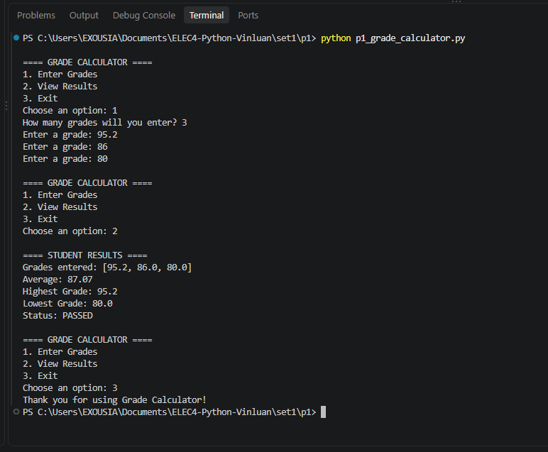


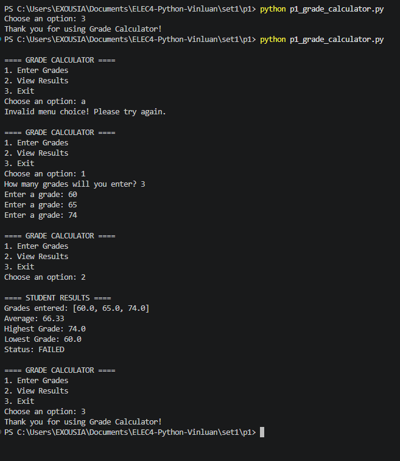


This activity demonstrates how to create and import a custom Python module containing functions for calculating and evaluating student grades. It also uses the built-in datetime module.


From the repository root:

```bash
cd set1/p2
python p2_main.py
```

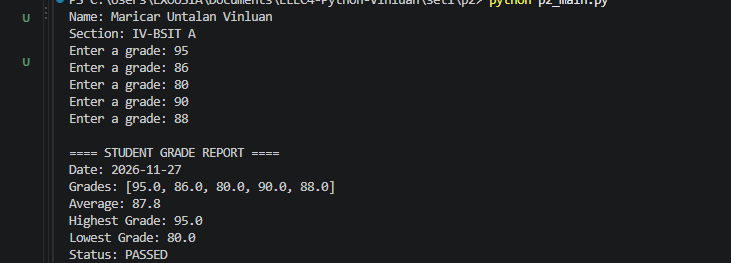


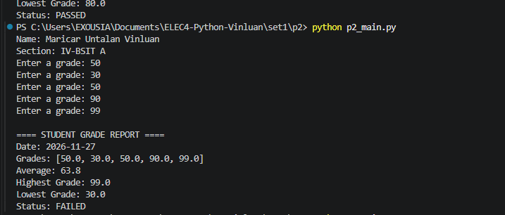


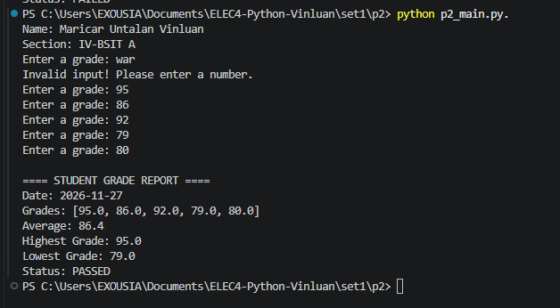


This activity demonstrates the use of lists and sets in managing student records. The program allows users to add, remove, search, and display student names while preventing duplicate entries.


From the repository root:

```bash
cd set1/p3
python p3_record_manager.py
```

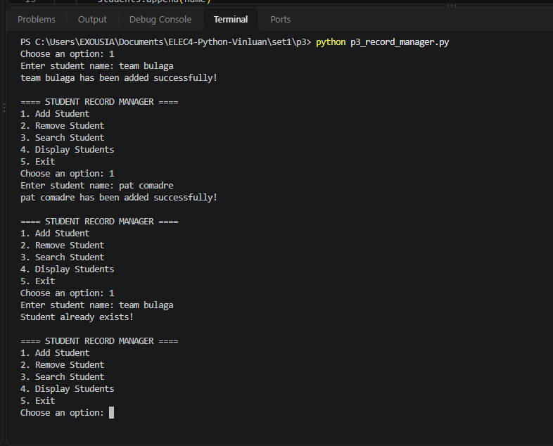


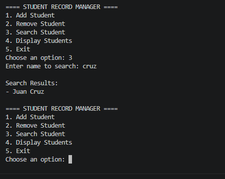


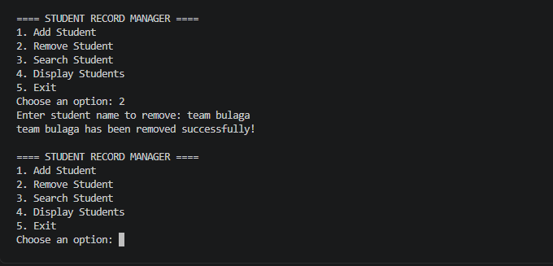


This activity demonstrates exception handling using try, except, else, and finally. The program handles invalid numbers, division by zero, missing files, and invalid menu choices.


From the repository root:

```bash
cd set1/p4
python p4_exceptions.py
```

Enter sample.txt when testing the file reading option.


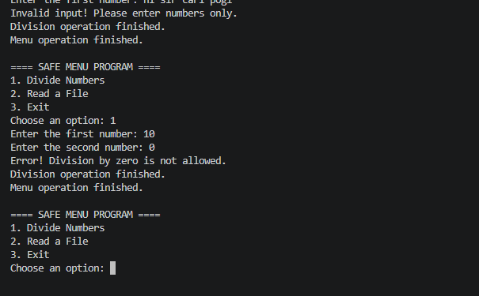


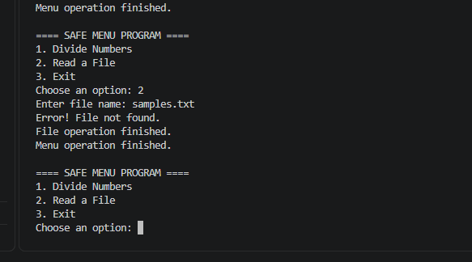


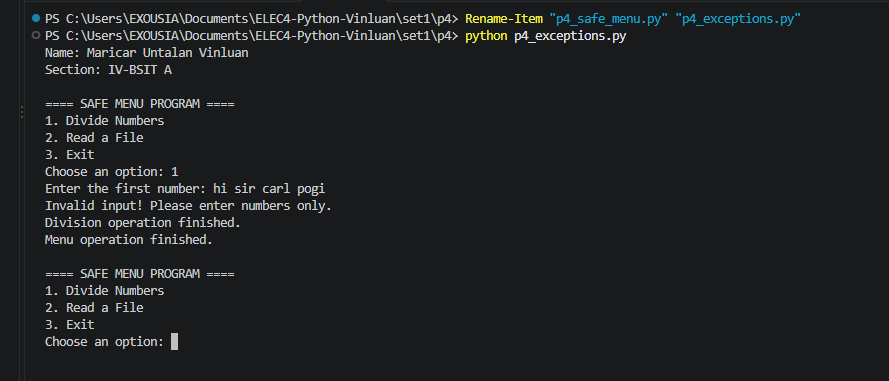


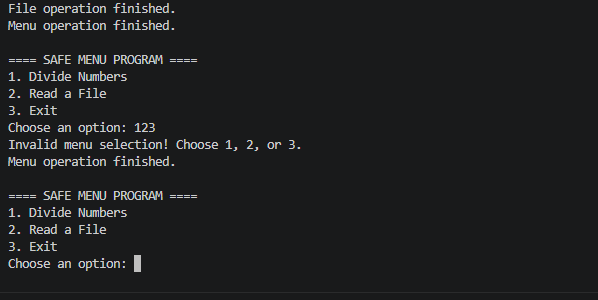

## Learning Outcomes

Through these activities, I learned how to:

- Create and use Python functions.
- Calculate and evaluate student grades.
- Create and import custom modules.
- Use built-in Python modules.
- Manage records using lists and sets.
- Validate user input.
- Handle exceptions using try, except, else, and finally.
- Use Git and GitHub for version control.

## Author

Maricar Untalan Vinluan  
IV-BSIT A  
ELEC 4 - Python Programming